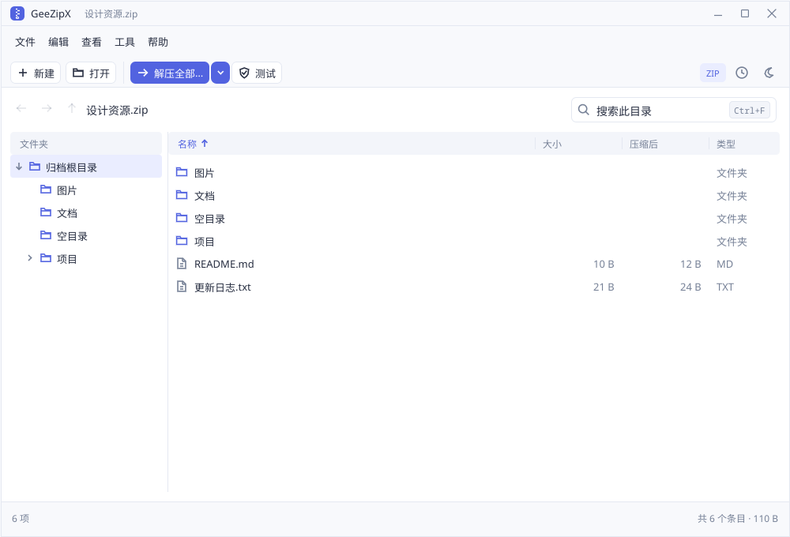
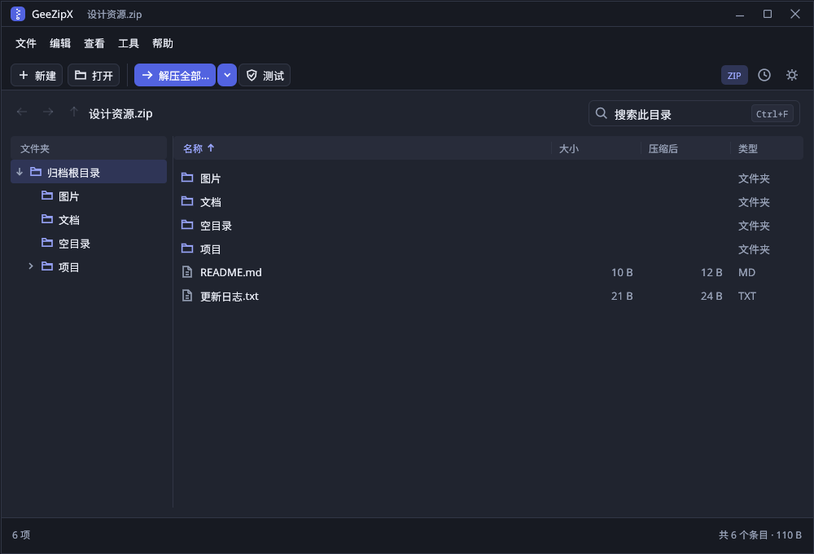
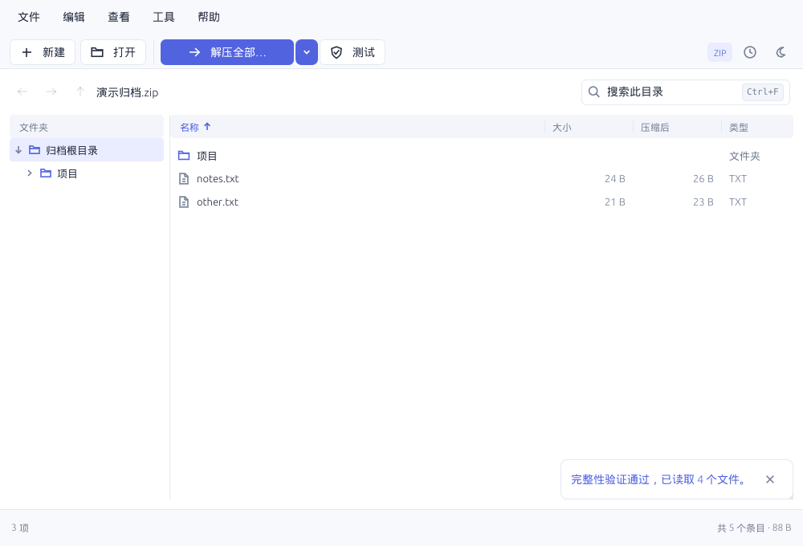
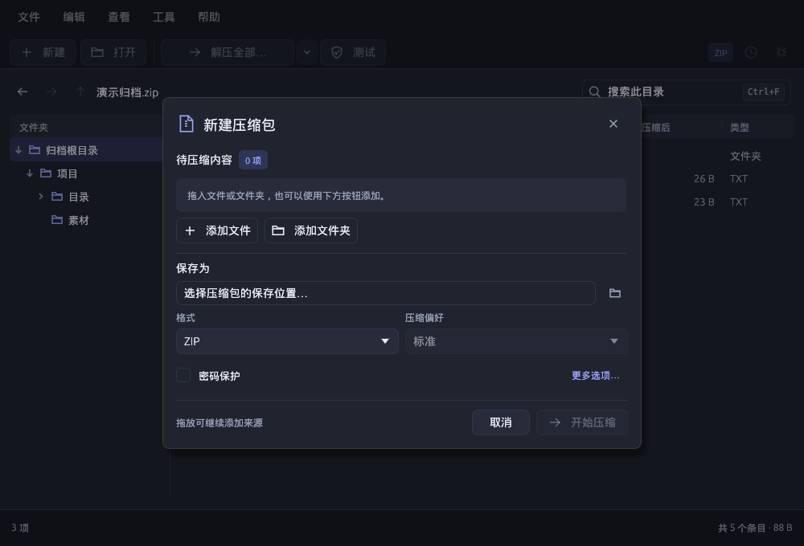
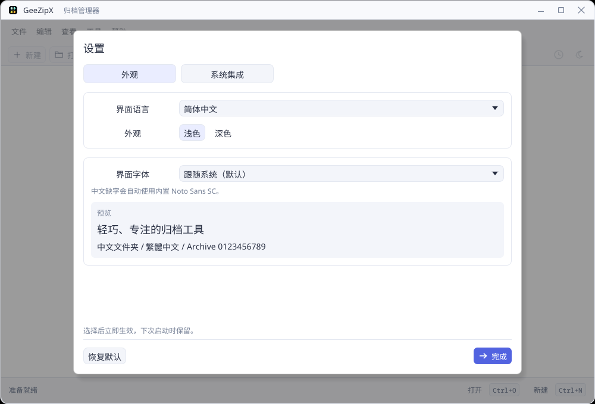
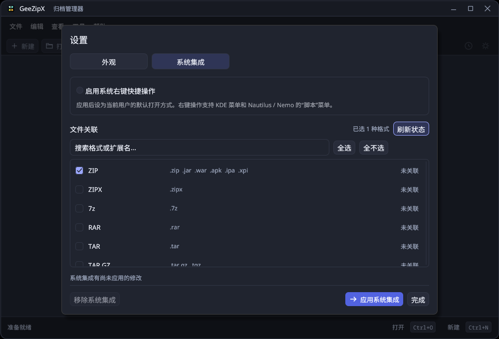
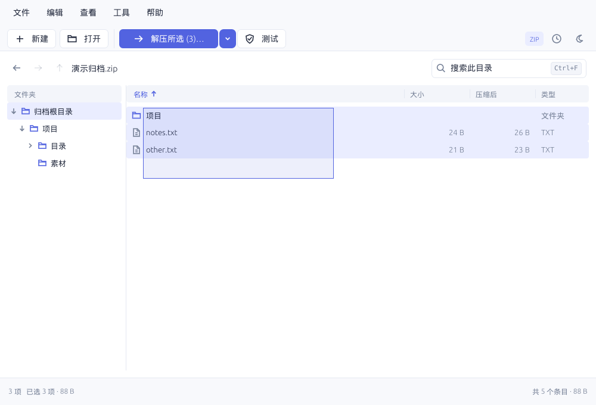

# GeeZipX（egui 桌面端）

GeeZipX 是项目唯一的桌面应用，包名和可执行文件名为 `geezipx-egui`，当前开发版本为 **0.10.0**（尚未发布）。它使用 egui/eframe 0.33.3、Glow/OpenGL 渲染器和系统文件对话框，直接调用 `geezipx-core`。

本阶段目标是形成可实际使用的原生归档工作空间，完成基础压缩、解压、浏览、预览、验证和取消操作。

## 运行和构建

需要 Rust 1.99（workspace MSRV）；根目录 `rust-toolchain.toml` 与 CI 统一使用 1.99.0，包含 rustfmt 和 Clippy。

```sh
# 开发运行
cargo run -p geezipx-egui

# 打开归档；也可传入多个文件、文件夹创建压缩包
cargo run -p geezipx-egui -- /path/to/archive.zip
cargo run -p geezipx-egui -- /path/to/folder /path/to/report.pdf

# 优化构建
cargo build -p geezipx-egui --release --locked
# Linux/macOS: target/release/geezipx-egui
# Windows: target/release/geezipx-egui.exe

# 可选：去掉 RAR、WIM、ZPAQ 后端
cargo run -p geezipx-egui --no-default-features
```

可选后端 `rar`、`wim`、`zpaq` 默认全部启用。Unix release 构建建议设置 `CXXFLAGS=-fno-lto` 避免 ZPAQ C++/Rust 跨语言 LTO 链接不兼容；Windows MSVC 构建前设置 `RUSTFLAGS=-C target-feature=+crt-static` 统一 C++ 运行库。独立工作流已包含这些设置。`--no-default-features` 同时关闭三个后端，可用 `--features rar,wim,zpaq` 按需启用。

Linux 运行需要桌面显示服务、可用的 OpenGL 驱动，以及提供文件选择器的 XDG Desktop Portal。构建不依赖 GTK/WebKitGTK 开发包。Linux 同时启用 X11 和 Wayland。macOS/Windows 使用系统原生文件对话框。界面优先使用系统字体：Windows 的 Segoe UI/微软雅黑、macOS 的系统无衬线/苹方，Linux 按 Fontconfig 的无衬线与等宽字体配置查找。系统缺少的中文字形由内嵌 Noto Sans SC 2.004（SIL OFL 1.1）逐字补齐，因此无需联网或预装中文字体；字体只在启动时查找一次，系统字体不会打包或复制到安装目录。许可证及 egui 默认字体的版权/许可见 `crates/gui-egui/assets/*.txt`，也可在“帮助 → 关于 GeeZipX”查看。

根目录 `cargo build` / `cargo test` 默认只选择 core、CLI，保持无桌面依赖的命令行构建。原生 GUI 通过 `-p geezipx-egui` 显式选择；`--workspace` 会包含 egui GUI。

## 界面与操作

采用蓝紫色主操作、低对比背景、细边框和统一的圆角/间距。应用图标采用透明背景的蓝紫色双折带 Z，原稿保存在 `crates/gui-egui/assets/icon.svg`；`assets/icon.png` 为 512×512，供原生窗口、标题栏、欢迎页和关于页共用，`windows/icon.ico` 包含 16/24/32/48/64/128/256 像素版本，供 Windows EXE、安装器和 Explorer 身份包共用。线条图标、主/次按钮、复选框、文件行和空状态通过 egui Painter 自绘；菜单、输入框和对话框共享浅/深色语义配色，保留悬停、禁用、键盘焦点和辅助功能信息。

窗口关闭系统标题栏与装饰边框，由 `window_frame.rs` 绘制 32 点高的标题栏和 1 点细边框，与浅/深色主题同步。普通窗口使用 12 点圆角与透明外角，标题栏、状态栏和对话框遮罩保持相同轮廓；Linux 桌面需要合成器显示外角透明。标题栏显示应用图标、名称和当前归档名，右侧提供紧凑的最小化、最大化/还原与关闭按钮；空白处可拖动窗口，双击切换最大化/还原，四边和四角可调整尺寸。最大化或全屏时使用直角，并隐藏缩放热区和细边框。窗口控制在对话框打开时仍可用，关闭窗口沿用后台任务的取消确认与清理流程。

主窗口使用菜单、紧凑工具栏、路径/搜索栏、左侧目录树、文件表格和底部状态栏。目录树可调整宽度，单击文件夹切换目录，展开按钮只控制子目录显示并保持树的滚动位置；与列表、面包屑及前进/返回同步，不受名称搜索或列表排序影响。默认窗口 1000×680，最小 760×480（逻辑像素）；文件行高 29。顶部菜单标题高度 24，操作按钮高度 28，工具栏按钮按文字内容收缩，图标按钮为 28×28；欢迎页成对按钮宽 118，对话框的“完成”等动作也按内容收缩。点击打开任一顶部菜单后，悬停其它菜单标题即可切换；菜单关闭时仍需点击打开，重复点击当前标题、按 Esc 或点击外部可关闭。快捷键按当前平台显示，菜单内动作与快捷键独立对齐；搜索框右侧使用单独的快捷键提示或清除按钮，工具栏悬停提示与底部快捷操作提示采用一致样式。新建、解压和任务记录按需打开对话框，统一 16 点内边距，主要操作按钮独立于设置滚动区域。

- **打开与浏览**：点击“打开”、拖入单个归档，或将归档路径作为启动参数。双击目录进入，子目录列表第一项固定显示文件夹图标的 `..`，双击返回上一级并定位刚离开的文件夹；`..` 不参与选择、框选、全选和解压，搜索无结果时也保留。支持返回/前进、上一级与面包屑；按名称、大小、压缩后大小、类型排序，拖动列头分隔线调整列宽。名称搜索只过滤当前目录，直接输入文件名前缀可定位；Windows 反斜杠条目与隐式文件夹合并为同一目录树。
- **选择与解压**：单击选中，Ctrl/Cmd 切换选择，Shift 连选，点击空白清空。从列表空白或未选行的大小/类型等区域拖动可框选，Ctrl/Cmd 框选切换命中条目，Shift 框选追加；靠近列表上下边缘会自动滚动。切换目录清空选择，排序/缩放保留选择，搜索保留选择并报告被筛选隐藏的项目数。目录选择包含全部后代。主按钮随选择显示“解压全部…”或“解压所选 (N)…”，`Ctrl/Cmd+E` 打开目标对话框；下拉菜单始终保留解压全部，并提供全部解压到同名文件夹或当前文件夹。
- **拖出解压**：从名称区域或已选条目开始拖动，支持目录、空目录、多选和中文名称，不改写归档；松手前不读取内容。Windows 在松手后通过 Shell/辅助功能元数据解析 Explorer 当前可见文件夹、子目录和桌面；桌面空白处使用系统登记的真实桌面目录（含 OneDrive/重定向），桌面文件夹图标使用其实际目录，直接启动 GeeZipX 后台解压任务：目标写入、进度、跳过同名文件、取消和结果记录由应用负责，不再创建整组选区暂存目录或 Explorer 复制任务。放回源窗口或按 Esc 取消；位置为虚拟目录、普通应用或无法可靠解析时，显示目录选择器，确认后继续解压。macOS 保留 Finder 文件承诺，Linux X11/XWayland 保留 `XdndDrop` 后的 URI 交付，必要暂存保留至退出；原生 Wayland 暂不支持。Windows 的 Explorer 标签页、桌面、DPI 和辅助功能兼容性仍需实机验收。
- **旧 ZIP 中文名称**：core 统一处理目录、预览定位与提取使用的名称，优先采用 Unicode 元数据/UTF-8；对未标编码、能无损解码且包含汉字的旧名称尝试 GB18030（含 GBK），其余保留 CP437 回退。旧 ZIP 不携带可靠代码页信息时，自动识别存在歧义；解码后重名会明确报错。
- **目标与覆盖策略**：解压默认输出到归档旁的同名文件夹，可编辑路径或使用系统目录选择器；支持完成后打开目标文件夹。默认跳过同名目标，可明确选择替换。工具栏快捷解压直接执行并跳过已有文件；系统右键快捷操作见下方“系统集成”。新建归档的替换开关位于“更多选项”。错误或取消不会把不完整临时文件替换为最终文件；解压失败会恢复原目标、选择快照和覆盖选项，直接修正后重试，密码重新输入。
- **新建压缩包**：点击“新建”开始空白任务；拖入普通文件/文件夹直接进入创建对话框。来源摘要可展开编辑，“添加文件”“添加文件夹”分别调用系统选择器；对话框内拖入 ZIP 等归档也作为压缩来源。自动建议保存位置，可选择格式与后端支持的压缩偏好；ZIP/ZIPX/7z 按需展开密码与确认输入，AES `.enc` 必须设置密码；ZIP 另可选择当前构建具备的 Windows/Linux/macOS x86_64 自解压目标。单流和 IMG/BIN/ISZ 只接受一个普通文件。保留每个顶层来源名称，消除重叠来源；拒绝来自不同目录的同名根条目。按 Enter 提交，密码保护开启但密码为空时阻止创建；创建失败自动恢复原来源、目标和密码保护意图，密码内容仍已清空。
- **验证与预览**：工具栏“测试”读取完整归档并验证引擎提供的校验，不写入解压目录。文本预览最多保留 512 KiB，显示截断说明；双击文件或使用右键菜单打开预览。不执行归档内程序。加密读取可在“工具”菜单填写下一次读取的密码，或在解压对话框启用密码输入；打开失败后支持输入密码重试。
- **设置布局**：“工具 → 设置…”分为“外观”和“系统集成”两页，底部提示与操作栏固定显示，最小窗口下只滚动当前页内容。“外观”的语言、主题、字体即时生效；“恢复默认”只重置这些外观选项。系统集成需单独应用，尚未应用时会提示；关闭前可继续编辑或明确放弃修改。
- **语言设置**：“工具 → 设置… → 外观 → 界面语言”提供简体中文（默认）和 English，切换立即生效并在重启后保留；菜单、归档浏览、新建/解压对话框、进度和任务结果使用所选语言。任务文案使用任务启动时的语言；归档文件名、路径、用户文本和 core/系统错误详情保持原样。系统文件选择器的标准按钮沿用操作系统语言。
- **字体设置**：“工具 → 设置… → 外观”可选择跟随系统、内置 Noto Sans SC 或已安装字体；下拉列表支持搜索，预览和界面即时更新，选择随偏好保存并在下次启动恢复，也可一键恢复默认。已保存字体被卸载或无法读取时自动回退到系统字体及中文后备。文本预览仍使用独立等宽字体。
- **进度、提示与取消**：成功、失败和操作提示以浮动消息显示在页脚上方右下角，按内容收缩宽度，长消息自动换行；2 秒后自动消失，鼠标悬浮期间重置计时，也可点击关闭。提示独立于页面布局，出现、替换或关闭均不改变页脚、工具栏和文件行的位置。后台操作在底部就近展开阶段、进度、当前条目、吞吐与剩余时间估计。后台操作期间仍可浏览、搜索和选择已加载目录；一次只运行一个引擎任务。取消使用明确按钮，Esc 不取消任务。“任务记录”保留本次启动的结果、耗时和错误，并可打开输出文件夹。退出时若仍有任务，会询问是否取消并等待清理。
- **主题与隐私**：右上角或“查看”菜单切换浅/深色。仅保存语言、字体、外观与最近八条路径；最近记录可在空窗口或“文件 → 最近打开”中清空。密码不序列化，压缩提交或关闭创建对话框时清空；读取密码在下一次预览、验证或解压提交时取走，关闭解压对话框也清空。

键盘：`Ctrl/Cmd+O` 打开、`Ctrl/Cmd+N` 新建、`Ctrl/Cmd+E` 解压、`Ctrl/Cmd+A` 全选当前列表、`Ctrl/Cmd+F` 搜索；`Alt+Left/Right` 返回/前进，`Backspace` 或 `Alt+Up` 上一级，方向键/`Home`/`End`/`PageUp`/`PageDown` 移动焦点，Shift 扩展选择，Space 切换当前项。Enter 打开目录、预览文件或提交操作对话框；Esc 先关闭菜单或弹层，再清除搜索或清空选择。编辑文本时不抢占全选、退格等输入操作。

Linux release 在 Xvfb + Openbox 虚拟桌面实跑的界面截图：
















## 系统集成

在“工具 → 设置… → 系统集成”页面中，可搜索格式名或扩展名、点击整行勾选格式，选择是否启用右键快捷操作，再点击“应用系统集成”。列表分别显示格式、扩展名和“默认 / 已注册 / 未关联”状态；全选/全不选作用于全部可用格式，搜索不会清除隐藏格式的勾选。“刷新状态”重新读取系统设置并保留待应用选择，应用失败也保留当前选择；移除入口需确认，清理本应用的注册。查询与更新在后台运行，操作期间禁用重复提交，关闭应用时等待清理。格式列表随 RAR/WIM/ZPAQ 编译特性变化；“默认”表示整组扩展名均指向本应用。Windows/macOS 选择 TAR.GZ 等复合扩展名时，会一并注册 GZIP 等外层格式，保证系统按最终后缀打开文件。关联不会扩展只读格式和变体的实际能力。SFX/NSIS 的 `.exe` 不进行全局关联，仍可从应用内打开。

- **Windows**：文件关联与菜单按当前用户注册，使用独立的 `GeeZipX.Native.*` ProgID、Capabilities 和 OpenWithProgids。注册后点击“系统默认应用”，由 Windows 确认打开方式；不改受保护的 `UserChoice`。Windows 11 的一级右键菜单使用 `IExplorerCommand`，在“GeeZipX”子菜单内提供五种操作；Windows 10 和“显示更多选项”保留传统级联菜单。两种菜单均传递完整多选，支持中文、空格和超出普通命令行长度的选区；解压入口仅对单个受支持归档显示。一级菜单需要安装包或便携包内的已签名 `GeeZipXShell.msix` 与 `geezipx_shell.dll`，并要求签名链受系统信任。安装与身份注册无需管理员权限；首次安装保持可选，升级修复已有注册，卸载先移除身份包，再清理自身菜单、ProgID、Capabilities 和 COM CLSID。
- **Linux**：需要 `xdg-mime` / `xdg-open`、`update-mime-database`（shared-mime-info）与 `update-desktop-database`（desktop-file-utils）。注册写入当前用户的 XDG 应用、MIME 和配置目录，仅为勾选格式添加文件名识别规则并设置默认程序；KDE 使用 ServiceMenu，Nautilus/Nemo 使用右键“脚本 → GeeZipX”。同组扩展名共用 MIME 默认设置。移除或取消所选格式时，只恢复仍指向本应用的默认项，保留后来选择的其它程序。
- **macOS**：使用系统 `osacompile`、`codesign`、LaunchServices 生成并注册 `~/Applications/GeeZipX.app`，其 AppleScript `open` handler 将 Finder 文件事件交付原生程序；`~/Library/Services/GeeZipX *.workflow` 提供 Finder“服务 / 快速操作”。系统可能要求确认默认程序或启用服务。移除时恢复记录的原默认项；没有原默认项时回退到系统归档实用工具，并清理用户启动器和服务。该启动器引用当前 EXE 路径，移动程序后重新应用设置。

菜单提供“压缩到…”（完整选区进入创建对话框）、“压缩为 ZIP”（在选区首项旁以其名称创建，已有输出不会被覆盖）、“解压到…”（选择目标）、“解压到当前位置”和“解压到同名文件夹”。归档可作为压缩来源。解压先成功打开并索引所请求的归档，再提交已有提取任务；密码错误、目标冲突、失败恢复、进度和取消沿用应用内流程。

维护参数在图形界面初始化前处理，可用于安装器和诊断：

```sh
geezipx-egui --shell-integration-status
geezipx-egui --register-shell-integration  # 显式注册所有可用格式和菜单
geezipx-egui --repair-shell-integration   # 仅修复已有注册
geezipx-egui --repair-shell-integration --menu=1 # 单独启用菜单，保留格式选择
geezipx-egui --repair-shell-integration --menu=0 # 单独移除菜单，保留格式选择
geezipx-egui --remove-shell-integration
geezipx-egui --shell-action compress -- /path/to/file /path/to/folder
geezipx-egui --shell-action extract-folder -- /path/to/archive.zip
```

`gui-egui.yml` 调用 `scripts/test-egui-windows-certificates.ps1`，在可清理的 Windows runner 中验证菜单选项不扩展格式关联、默认不导入、显式导入、已有证书保护、自定义目录无 `/D=` 升级、升级记录保留、显式保留证书和默认卸载移除，并检查不改动其它证书及根证书存储。

Windows 的注册归属与卸载检查由 `scripts/test-egui-windows-integration.ps1` 接入 `gui-egui.yml`；`scripts/test-egui-windows-explorer.ps1` 通过已注册的身份包激活实际 COM 扩展，检查枚举、选区状态、中文多选 ZIP 与解压结果，安装器随后执行原位升级并重复验收。工作流为临时验收目录下载并校验固定版本 Mesa 26.2.5 软件 OpenGL，完成后移除 DLL，不加入发布包。对应平台的默认应用确认、Explorer/Finder 菜单显示和交互仍需原生验收；检查项见 [发布清单](RELEASE_CHECKLIST.md)。

## 格式范围

egui 已接入当前 core 的全部格式能力：可写格式出现在创建列表，只读格式提供浏览、提取和测试，密码与格式变体限制沿用 core。

| 能力 | 格式 |
| --- | --- |
| 创建、浏览、解压、验证 | ZIP、ZIPX（XZ method 95）、7z、TAR、TAR.GZ、TAR.BZ2、TAR.BR、TAR.LZ4、TAR.XZ、TAR.ZST、CAB、ASAR、DEB、LZH/LHA、CPIO、ISO、UDF、WIM、ZPAQ |
| 单文件创建、打开、提取、验证 | GZIP、BZIP2、Brotli、LZ4、XZ、LZMA、Lzip、Zstandard、UU/UUE、XXE、AES `.enc` |
| 只读：浏览、提取、验证 | RAR、PMA、TLZ/TAR.LZMA/TAR.LZ、ALZ、Unix `.Z`、CFB/MSI/OLE、EGG、PEA、NSIS、ARJ、ACE、ARC；AES Crypt `.aes` 以一个文件显示 |
| 镜像创建与内容浏览 | IMG/IMA、BIN 创建为原样复制已有镜像；ISZ 包装一个 ISO。打开时浏览/提取镜像中的 ISO/UDF 文件，ISZ 为 ISO，测试时校验全部外层数据块（包含 ISO 文件未引用的块）再验证内部文件；不制作 FAT/NTFS/分区盘 |
| ZIP 自解压包 | ZIP 创建可选 SFX 平台，随后可直接打开、提取、测试；仅启用内嵌非空 stub 的目标，缺失的平台不可选。Linux/macOS 输出有执行权限 |
| 格式别名 | jar/war/apk/ipa/xpi 共用 ZIP reader；`.pma` 共用 LZH reader。读取支持与 core 相同，不能据此推断支持 ZIPX 专有方法 |

单流格式没有目录索引，打开时在后台完整解码至匿名临时文件以确定真实大小并验证完整性，再显示去掉外层扩展名的一个文件。未加密单流的解码结果随已打开归档缓存，预览、提取和拖出复用缓存及各自的取消控制；源文件身份、长度或修改时间变化后拒绝使用旧索引并要求重新打开，已打开归档及存活操作全部释放后回收缓存。测试仍重新读取来源，避免将缓存成功等同于原文件当前完整性。加密单流不跨操作复用明文，不保留密码；`.enc` 仍继承 core 的整体缓冲，AES Crypt 在认证通过前不暴露明文。创建默认输出保留完整输入文件名（`说明.txt` → `说明.txt.gz`），单流默认解压目录使用 `说明.txt-extracted`。首次打开仍有完整解码与临时磁盘开销。

密码创建支持 ZIP/ZIPX/7z/`.enc`，读取沿用 core 的 ZIP/ZIPX/7z/RAR/ALZ/ARJ/ACE/ARC/`.enc`/`.aes` 密码接口及各自兼容范围。7z 的 solid、字典和文件名加密等高级创建选项仍通过 CLI 使用。WIM 创建为无压缩，XPRESS 可读；LZX 互操作、LZMS、SWM 限制保留。ZPAQ 标准 journal 仅列出，不能重建文件内容。CAB 不保存独立空目录；LZH level-0 非 ASCII 名称读取时显示转义形式。EGG/PEA/NSIS/ALZ 的只读子集和其它 core 限制见 [格式审查](FORMAT_PARITY_AUDIT.md)。

## 性能和安全实现

- 压缩、扫描、归档索引、提取、验证、预览和文件对话框运行于工作线程。当前只运行一个后台操作，避免归档、密码、目标路径和取消状态互串。
- 文件列表和目录树均按可见行绘制，不为所有条目创建界面组件；目录树基于缓存目录索引，仅在展开或导航时重建展开节点，不访问文件系统；目录名称/大小/压缩后大小/类型顺序在后台预计算，行数据通过 `Arc` 共享；搜索只在条件变化时线性过滤当前目录的缓存，不复制名称、重新排序或访问文件系统。进度以共享快照和有限频率唤醒传递，不为每个读取块排队事件；空闲时不持续请求重绘。
- 提取、预览和验证使用 core `extract_entries`：顺序 reader 一次遍历；兼容 reader 先选区筛选，再将所选条目直接写向调用方，不再经过默认 visitor 的逐条临时文件。GUI 复用打开时的条目索引，避免压缩 TAR 在每次提取前再次列目录；测试仍独立重读来源。TAR/LZH/PMA 列目录使用 seek 跳过 payload，CPIO 复用上游头解析器并 seek，选区提取单次打开；7z 保留跨所有数据块的停止语义。TAR 创建仍通过 `add_entry_with_size` 流式写入并检查来源长度。
- 预览使用有界写入器；完整验证只保留缓冲块，结果统计采用饱和加法。其余格式继承 core 的实现：部分后端仍会缓冲完整条目，ZPAQ 等并不具备与 ZIP/TAR 相同的内存边界；不能把原生界面等同于所有格式的流式保证。
- 解压预检查本次选区的名称和输入自覆盖，再使用 core `ExtractionDir` 安全遍历与目标同目录临时文件提交；拒绝目录穿越、符号链接/重解析点目标、输入归档自覆盖及其硬链接别名。Windows 直接拖出先映射交付根，再执行相同安全检查，单文件提交不需要整组选区暂存和二次复制。压缩拒绝把输出放入输入目录，跳过符号链接和特殊文件。
- 取消为协作式：常规流式读写在块边界检查；个别后端的目录读取、原子编码步骤及最终落盘阶段可能需要等引擎返回。取消不是撤销，已完成提取的文件会保留。

## 验证与交付

```sh
cargo fmt --all --check
cargo clippy --workspace --all-targets --all-features -- -D warnings
cargo test --workspace --all-features
cargo test -p geezipx-egui --no-default-features
cargo build -p geezipx-egui --release --locked
cargo deny check
```

`crates/gui-egui/src/window_frame/tests.rs` 验证标题栏在发生拖动时发出原生移动命令、单击不抢占双击、双击最大化、最小化/还原、四边四角缩放方向、最大化时禁用缩放，以及对话框打开时的窗口按钮。macOS 的 winit 不支持原生拖动缩放，使用保持对边固定且不小于 760×480 的窗口位置/尺寸更新；`window_frame/resize.rs` 验证八个方向的计算与下限。`app/tests.rs` 另验证自绘关闭按钮沿用忙碌任务确认，空闲时正常关闭；圆角回归对真实绘制网格采样，覆盖浅深色、默认/最小窗口、无对话框/关于/新建，确认普通窗口四角透明、边缘不漏底，最大化/全屏时恢复不透明直角。

`crates/gui-egui/src/fonts.rs` 的回归测试使用隔离字体库，覆盖无系统字体时离线显示简繁中文、仅有西文字体时逐字回退、系统中文字体优先于内置 Noto、损坏字面/无效集合索引/不可读文件/不适合界面文字的位图与符号字体跳过，以及中文后备和手选字体不改变西文等宽显示。字体设置回归另覆盖菜单入口、点击搜索和筛选后选择、Esc 先关闭字体列表、恢复默认、旧偏好迁移与重启持久化、已卸载字体回退，以及深浅色最小窗口下的主按钮可见性。

Linux release 在隔离 Xvfb 实窗中验证：仅有西文字体和无系统字体两种环境均能离线显示中文；搜索并选择已安装字体及内置 Noto 即时生效，关闭并重启后保留选择；移走已选字体文件后，设置页说明字体不可用并显示系统/中文后备，恢复默认后清除此状态；760×480 深色设置页的预览和操作按钮完整可见。

`crates/gui-egui/tests/operations.rs` 覆盖全部多文件创建格式的嵌套目录往返与格式支持的名称/空目录（CAB 不存空目录，LZH 使用 ASCII 名称）、ZIP/ZIPX/7z 密码、选中目录边界、Windows 分隔符、覆盖/跳过、重复/重叠来源、目标别名、取消清理、损坏 ZIP、预览上限及 Unix 链接防护。`crates/core/tests/streaming_visitor.rs` 覆盖 TAR 流式输入和 7z 多块停止。

`crates/gui-egui/tests/format_parity.rs` 另覆盖全部可写单流的真实字节、名称与大小、预览、验证和所选提取，AES Crypt 官方 v3 认证失败时的原目标保护，PMA/EGG/PEA/NSIS/WIM XPRESS 外部语料，ISO → IMG/BIN/ISZ 内容浏览与提取、ISZ 未访问数据块损坏检测，以及当前构建可用 SFX 目标的生成与读取。单流/镜像创建拒绝目录输入和多来源；`.enc` 拒绝空密码；取消或校验失败保留原输出。

`crates/gui-egui/src/app/tests.rs` 覆盖各对话框、压缩格式、深浅色和不同窗口尺寸的真实 egui 布局，检查最小尺寸下主按钮未被裁切、缩放保留选择、键盘范围选择与解压快照、Enter 密码校验、失败后恢复设置且不保留密码，以及 Esc 不取消后台任务；展开菜单的布局回归检查覆盖 Windows/macOS 快捷键格式、动作与快捷键间距、文本完整显示，以及 Esc 关闭菜单后保留文件选择；浮动提示回归检查覆盖短/长消息替换、首帧定位、页脚及文件行位置不变、空闲自动消失、静止悬浮重置计时和手动关闭保留选择。Linux release 在隔离 Xvfb 桌面实跑验证了目录导航/搜索、选择性提取排除同名前缀目录、760×480 布局，以及在保存路径输入框按 Enter 创建 ZIP；创建结果另通过 Python ZIP CRC/Unicode 内容与空目录检查。浮动提示另经浅/深色 release 实窗验收：消息只改变右下角的局部像素，自动消失或手动关闭后工作区截图与提示前一致；鼠标静止悬浮超过 5 秒仍保留消息，移开后重新倒计时，并检查 760×480 下提示位于页脚上方。

`crates/gui-egui/tests/direct_extract.rs` 验证松手前不创建目标、直接输出所选根及中文空目录、源文件变化时拒绝旧索引、单流缓存使用新操作的取消控制，以及测试重新读取原始压缩数据并发现 CRC 损坏。`crates/core/tests/direct_selected.rs` 验证兼容 reader 不解码未选条目、不再建立逐条中转，并检查 TAR/LZH 元数据读取不经过大 payload；CPIO 单测对 newc/odc 检查 seek 扫描和取消。Linux release 在隔离 Xvfb 中打开含 10 GiB 条目的稀疏 TAR，并成功预览末尾 `last.txt`；这验证大跨度跳读与条目定位，不作为真实 10 GiB 数据的完整解压吞吐结果。Windows GNU 目标检查不能替代真实 Explorer 运行。

文件行以归档路径/条目路径确定 ID，目录激活另按条目记录成对点击，避免 egui 全局三击计数影响连续导航；Windows 使用系统双击间隔，其余平台默认 500 ms。导航工具提示的方向键使用绘制图标。`crates/gui-egui/src/app/tests.rs` 覆盖超过 300 ms 的双击、快速进入嵌套目录、返回后再次进入、树展开与单击导航、过滤时保留父目录行、`..` 双击返回并定位原子目录、带父目录行的框选及拖动不启动解压；`tests/drag_export.rs` 覆盖松手前零读取、放置后只解压一次、中文目录和空目录。Linux Xvfb 已有一次 Xdnd 拖动交付验收；Windows 新路径与 Finder 的大文件、覆盖、取消和 DPI 行为仍需实机验收。

`.github/workflows/gui-egui.yml` 在打包前重建对应平台的 x86_64 SFX stub，三平台均启用 RAR/WIM/ZPAQ 完整格式测试；macOS GUI 本身为 arm64，其自解压 stub 仍为 x86_64。工作流对 Linux x86_64（`ubuntu-24.04`）、Windows x86_64（`windows-latest`）、macOS arm64（`macos-latest`）执行检查、测试、release 编译，上传裸可执行文件、许可证和原生程序压缩包；artifact action 使用 Node.js 24 的 `actions/upload-artifact@v7`。压缩包分别为 `geezipx-egui-linux-x86_64.tar.gz`、`geezipx-egui-macos-arm64.tar.gz`、`geezipx-egui-windows-x86_64.zip`，附带许可证、字体许可、提交标识和 SHA-256。Windows 额外上传 `geezipx-egui-windows-x86_64-installer`，内含 `GeeZipX_<version>_x64-setup.exe`、`SHA256SUMS.txt` 和标明提交的 `build-info.json`。可在 Actions 手动触发并选择测试分支；安装包 artifacts 保留 30 天。`release.yml` 在 `main` 每次推送后自动复用该工作流，统一校验 CLI/GUI 产物及实际上传文件，再公开发布 `v<workspace版本>-beta.<run_number>` GitHub Pre-release；版本标签中的 beta 编号区分各次开发构建，应用与安装器仍使用 Cargo 中的基础版本。beta 不替换最新正式版，不发布 crates.io。正式 `vX.Y.Z` tag 继续生成 Release 草稿；Linux/macOS 暂不提供安装器。

Windows 安装与卸载界面沿用软件浅色主题的 `#F8F9FC` 背景、`#262D40` 文字、蓝紫色图案和共享图标；`windows/installer-theme.nsh` 集中样式，侧栏与页眉 BMP 由 `assets/icon.png` 生成。保留原生控件的键盘焦点与 DPI 缩放，支持简体中文/英文。默认安装到 `%LOCALAPPDATA%\Programs\GeeZipX`，应用本身按用户安装，无需管理员权限；可选测试证书操作单独请求管理员权限。添加 GeeZipX 开始菜单入口和卸载项。升级通过当前用户卸载项 `InstallLocation` 自动选择已安装路径，无需重复指定 `/D=`；目录页明确提示覆盖安装，显式 `/D=` 仍可覆盖预选路径。升级复用已记录的安装路径并清理旧名称快捷方式。安装选项提供“启用 Windows 11 一级右键菜单”，新安装默认关闭，升级按已有菜单状态预选；选择只影响菜单，不新增格式关联，取消后也会移除先前启用的菜单。EXE 的多分辨率 ICO 与产品信息由 `build.rs` / `winresource` 嵌入，安装验收直接检查 PE 图标资源，确保资源管理器、快捷方式与关联图标可从 EXE 获取。安装目录内 `build-info.txt` 标明版本与提交。安装器同时交付 EXE、Shell DLL 和稀疏 MSIX，不能单独移动 EXE 后期待一级菜单继续工作；移动完整便携目录后重新应用系统集成。升级在替换 DLL 前注销身份包，再按原设置注册；卸载先清理系统集成，再清理本安装器的文件和入口，保留应用偏好、最近记录及用户自行放入的文件。如果扩展仍被占用，安装/卸载返回失败并保留可重试的文件。安装器脚本位于 `crates/gui-egui/windows/installer.nsi`，需要 NSIS 3；构建时传入 `APP_VERSION` 与 `APP_REVISION`；包含测试公钥时还需传入与公钥一致的 `TEST_CERT_THUMBPRINT`。

Windows 构建需要 Windows SDK 的 MakeAppx、SignTool 和 `mt.exe`。签名身份必须在 Cargo 编译前配置，以确保 DLL 嵌入的身份与 MSIX 的 Publisher 一致。正式 tag 发布使用受信任的代码签名证书：GitHub secrets `WINDOWS_CERTIFICATE_PFX` 为 PFX 的 Base64，`WINDOWS_CERTIFICATE_PASSWORD` 为其密码。`release.yml` 要求正式发布使用这些凭据，缺失时构建失败；main beta、PR、手动测试及 release dry-run 使用临时测试证书，测试安装器提供以下明确选择：

- 只有在“安装选项”勾选一级右键菜单后，点击“下一步”才显示“测试证书”页。该页解释测试版 Windows 11 一级右键扩展使用自签名证书、Windows 默认不信任，因此启用一级菜单需要信任证书；不安装仍可正常压缩、解压和浏览归档。“安装此测试版本的签名证书”默认不勾选。从证书页返回并取消菜单会清除本次证书安装选择。测试包若因跳过证书而无法启用系统快捷菜单，会提示稍后在“设置 → 系统集成”中重新应用，主程序完成安装。
- 勾选后仅证书操作通过 UAC 请求管理员权限，将随包公钥导入 `Cert:\LocalMachine\TrustedPeople`，不导入 `Root`，不分发私钥。操作失败或取消授权会返回失败，保留可重试的应用与记录。
- 安装器按精确指纹记录自己新添加的证书，升级保留记录；安装前已经存在的证书不会被认领。卸载在存在记录时提供默认勾选的“移除此安装器添加的测试证书”，可移除包括旧版本在内的记录项；未勾选则保留。移除可能影响仍使用相同证书的其它测试副本。
- 静默安装使用 `/S /MENU=1 /INSTALLCERT=1` 显式启用测试菜单并导入证书；`/MENU=0` 禁用菜单，未指定时沿用已有菜单状态。`/INSTALLCERT=1` 要求同时启用菜单。静默卸载默认移除安装器记录的测试证书，使用 `/S /REMOVECERT=0` 明确保留，`/REMOVECERT=1` 显式移除；证书操作仍可能触发 UAC。不含测试公钥的正式安装器不显示安装证书选项，但仍可清理由此前测试安装器记录的证书。

开发机测试构建（签名配置脚本显式将临时公钥导入本机 `TrustedPeople` 和 `Root`，分别用于 MSIX 安装和 EXE/DLL 的 Authenticode 验证；两者均需要管理员权限，只用于可清理的测试环境。安装器的可选导入只使用 `TrustedPeople`。使用本机 `Root` 可避免当前用户根证书导入时弹出的确认窗口阻塞无人值守构建；工作流中的签名配置步骤限时 5 分钟）：

```powershell
./scripts/configure-egui-windows-signing.ps1 -TestCertificate
cargo build -p geezipx-egui -p geezipx-shell --release --locked
./scripts/build-egui-windows-shell.ps1
```

测试 artifact 附带 `GeeZipXShell-test.cer`；使用安装器时可在证书页选择导入。便携包仍需由测试者明确导入 `Cert:\LocalMachine\TrustedPeople`，再启用菜单，例如在管理员 PowerShell 执行 `Import-Certificate -FilePath .\GeeZipXShell-test.cer -CertStoreLocation Cert:\LocalMachine\TrustedPeople`；手工导入的证书由测试者自行移除。证书只供测试，正式用户包使用受信任签名。正式本地构建先运行 `configure-egui-windows-signing.ps1 -CertificateThumbprint <CurrentUser\My 中的受信任签名证书指纹>`，再执行相同的 Cargo 与打包命令。

本阶段不含多标签并发、原生 Wayland 拖出、归档内重命名/删除、二进制预览、逐文件冲突询问/自动重命名、分卷创建、自动更新和 Linux/macOS 安装器。暂未提供屏幕阅读器验收或完整 DPI/输入法兼容性报告；正式发版前需在 Windows/macOS/Linux 实机验证拖放、系统文件选择器、输入法和显示缩放。
