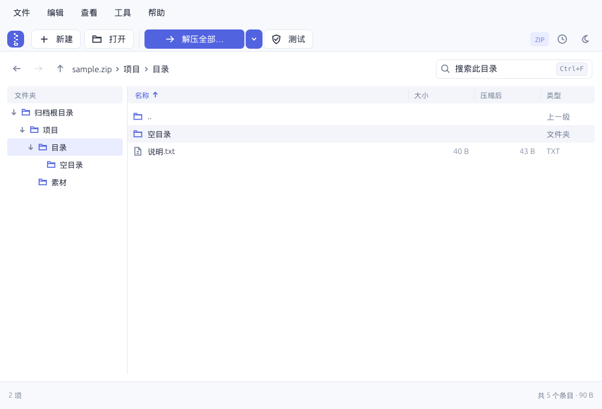
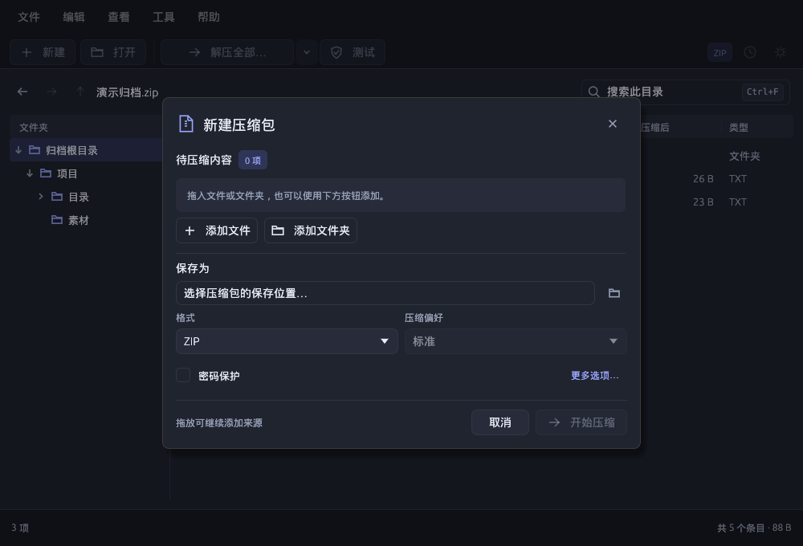
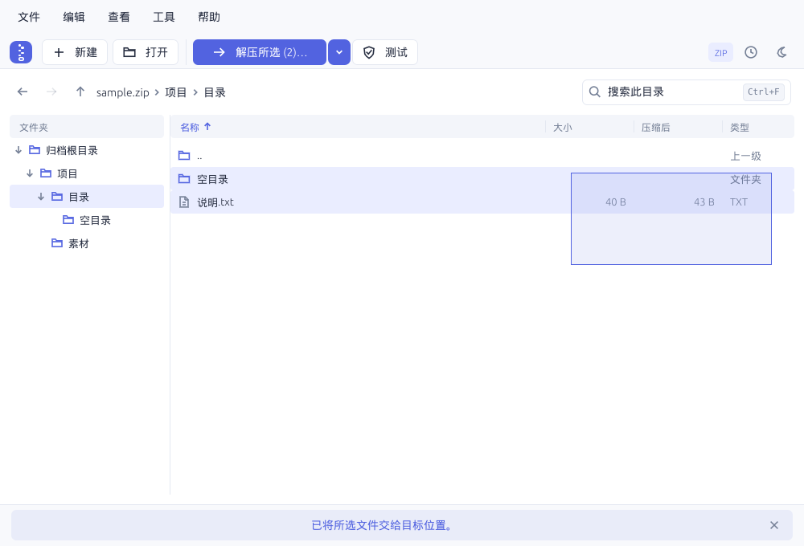

# GeeZipX Native（egui 桌面端）

GeeZipX Native 是与 Tauri 桌面端并行的独立 Rust 应用，包名和可执行文件名为 `geezipx-egui`。它使用 egui/eframe 0.33.3、Glow/OpenGL 渲染器和系统文件对话框，直接调用 `geezipx-core`；构建和运行不需要 Node.js、Tauri、WebView2 或 WebKitGTK。

本阶段目标是形成可实际使用的原生归档工作空间，完成基础压缩、解压、浏览、预览、验证和取消操作。性能收益尚未做与 Tauri 的同机对照测量，不宣称固定的内存、启动时间或吞吐提升。

## 运行和构建

需要 Rust stable（workspace MSRV 为 1.96）。

```sh
# 开发运行
cargo run -p geezipx-egui

# 打开归档；也可传入多个文件、文件夹创建压缩包
cargo run -p geezipx-egui -- /path/to/archive.zip
cargo run -p geezipx-egui -- /path/to/folder /path/to/report.pdf

# 优化构建
cargo build -p geezipx-egui --release --locked
# Linux/macOS: target/release/geezipx-egui
# Windows: target/release/geezipx-egui.exe

# 可选：去掉 RAR 后端
cargo run -p geezipx-egui --no-default-features
```

Linux 运行需要桌面显示服务、可用的 OpenGL 驱动，以及提供文件选择器的 XDG Desktop Portal。构建不依赖 GTK/WebKitGTK 开发包。Linux 同时启用 X11 和 Wayland。macOS/Windows 使用系统原生文件对话框。中文字体内嵌，因此无需联网或预装中文字体；许可证及 egui 默认字体的版权/许可见 `crates/gui-egui/assets/*.txt`，也可在“帮助 → 关于 GeeZipX”查看。

根目录 `cargo build` / `cargo test` 默认只选择 core、CLI，保持无桌面依赖的命令行构建。原生 GUI 通过 `-p geezipx-egui` 显式选择；`--workspace` 仍会包含两个 GUI 包。

## 界面与操作

采用蓝紫色主操作、低对比背景、细边框和统一的圆角/间距。线条图标、主/次按钮、复选框、文件行和空状态通过 egui Painter 自绘；菜单、输入框和对话框共享浅/深色语义配色，保留悬停、禁用、键盘焦点和辅助功能信息。

主窗口使用菜单、紧凑工具栏、路径/搜索栏、左侧目录树、文件表格和底部状态栏。目录树可调整宽度，单击文件夹切换目录，展开按钮只控制子目录显示并保持树的滚动位置；与列表、面包屑及前进/返回同步，不受名称搜索或列表排序影响。默认窗口 1000×680，最小 760×480（逻辑像素）；文件行高 29。菜单和主要控件高度 32，快捷键按当前平台显示，菜单内动作与快捷键独立对齐；搜索框右侧使用单独的快捷键提示或清除按钮，工具栏悬停提示与底部快捷操作提示采用一致样式。新建、解压和任务记录按需打开对话框，统一 16 点内边距，主要操作按钮独立于设置滚动区域。

- **打开与浏览**：点击“打开”、拖入单个归档，或将归档路径作为启动参数。双击目录进入，子目录列表第一项固定显示文件夹图标的 `..`，双击返回上一级并定位刚离开的文件夹；`..` 不参与选择、框选、全选和解压，搜索无结果时也保留。支持返回/前进、上一级与面包屑；按名称、大小、压缩后大小、类型排序，拖动列头分隔线调整列宽。名称搜索只过滤当前目录，直接输入文件名前缀可定位；Windows 反斜杠条目与隐式文件夹合并为同一目录树。
- **选择与解压**：单击选中，Ctrl/Cmd 切换选择，Shift 连选，点击空白清空。从列表空白或未选行的大小/类型等区域拖动可框选，Ctrl/Cmd 框选切换命中条目，Shift 框选追加；靠近列表上下边缘会自动滚动。切换目录清空选择，排序/缩放保留选择，搜索保留选择并报告被筛选隐藏的项目数。目录选择包含全部后代。主按钮随选择显示“解压全部…”或“解压所选 (N)…”，`Ctrl/Cmd+E` 打开目标对话框；下拉菜单始终保留解压全部，并提供全部解压到同名文件夹或当前文件夹。
- **拖出解压**：从名称区域或已选条目开始拖动，立即向系统提供所选文件/目录的描述信息；仅在目标位置松开鼠标、接收方请求内容后，才复用安全提取引擎解压并交付，一次拖动即可完成。悬停、取消和未接收的放置不读取归档，不再预先解压或要求二次拖动。支持目录、空目录、多选和中文名称，不改写归档。Windows 使用 `FILEGROUPDESCRIPTORW` / `FILECONTENTS` 虚拟文件与 `IStream`，macOS 使用 Finder 文件承诺，Linux X11/XWayland 在 `XdndDrop` 后提供 URI；原生 Wayland 暂不支持。必要暂存保留至退出，兼容接收方延迟读取。
- **旧 ZIP 中文名称**：core 统一处理目录、预览定位与提取使用的名称，优先采用 Unicode 元数据/UTF-8；对未标编码、能无损解码且包含汉字的旧名称尝试 GB18030（含 GBK），其余保留 CP437 回退。旧 ZIP 不携带可靠代码页信息时，自动识别存在歧义；解码后重名会明确报错。
- **目标与覆盖策略**：解压默认输出到归档旁的同名文件夹，可编辑路径或使用系统目录选择器；支持完成后打开目标文件夹。默认跳过同名目标，可明确选择替换。工具栏快捷解压直接执行并跳过已有文件；这属于应用内操作，尚未注册系统右键菜单。新建归档的替换开关位于“更多选项”。错误或取消不会把不完整临时文件替换为最终文件；解压失败会恢复原目标、选择快照和覆盖选项，直接修正后重试，密码重新输入。
- **新建压缩包**：点击“新建”开始空白任务；拖入普通文件/文件夹直接进入创建对话框。来源摘要可展开编辑，“添加文件”“添加文件夹”分别调用系统选择器；对话框内拖入 ZIP 等归档也作为压缩来源。自动建议保存位置，可选择格式与后端支持的压缩偏好；ZIP/7z 按需展开密码与确认输入。保留每个顶层来源名称，消除重叠来源；拒绝来自不同目录的同名根条目。按 Enter 提交，密码保护开启但密码为空时阻止创建；创建失败自动恢复原来源、目标和密码保护意图，密码内容仍已清空。
- **验证与预览**：工具栏“测试”读取完整归档并验证引擎提供的校验，不写入解压目录。文本预览最多保留 512 KiB，显示截断说明；双击文件或使用右键菜单打开预览。不执行归档内程序。加密读取可在“工具”菜单填写下一次读取的密码，或在解压对话框启用密码输入；打开失败后支持输入密码重试。
- **进度与取消**：成功、失败和操作提示均显示在底部固定状态区，出现或关闭提示不会移动工具栏和文件行。后台操作在底部就近展开阶段、进度、当前条目、吞吐与剩余时间估计。后台操作期间仍可浏览、搜索和选择已加载目录；一次只运行一个引擎任务。取消使用明确按钮，Esc 不取消任务。“任务记录”保留本次启动的结果、耗时和错误，并可打开输出文件夹。退出时若仍有任务，会询问是否取消并等待清理。
- **主题与隐私**：右上角或“查看”菜单切换浅/深色。仅保存外观与最近八条路径；最近记录可在空窗口或“文件 → 最近打开”中清空。密码不序列化，压缩提交或关闭创建对话框时清空；读取密码在下一次预览、验证或解压提交时取走，关闭解压对话框也清空。

键盘：`Ctrl/Cmd+O` 打开、`Ctrl/Cmd+N` 新建、`Ctrl/Cmd+E` 解压、`Ctrl/Cmd+A` 全选当前列表、`Ctrl/Cmd+F` 搜索；`Alt+Left/Right` 返回/前进，`Backspace` 或 `Alt+Up` 上一级，方向键/`Home`/`End`/`PageUp`/`PageDown` 移动焦点，Shift 扩展选择，Space 切换当前项。Enter 打开目录、预览文件或提交操作对话框；Esc 先关闭菜单或弹层，再清除搜索或清空选择。编辑文本时不抢占全选、退格等输入操作。

Linux release 在虚拟桌面实跑的界面截图：








## 格式范围

原生端有自己的适配器清单，core/CLI 支持不代表原生端自动支持；Tauri 的清单也不代表原生端的清单。

| 能力 | 格式 |
| --- | --- |
| 创建、浏览、解压、验证 | ZIP、7z、TAR、TAR.GZ、TAR.BZ2、TAR.BR、TAR.LZ4、TAR.XZ、TAR.ZST；启用 `zpaq` feature 后另含 ZPAQ |
| 浏览、解压、验证 | RAR（默认 feature）、CAB、ASAR、CPIO、DEB、LZH/LHA、ISO、UDF、ARJ、ACE、ARC |
| ZIP 别名 | zipx/jar/war/apk/ipa/xpi 等由 core 检测为 ZIP；不增加 WinZip 专有方法支持 |
| 未接入 | 单流 gz/bz2/br/lz4/xz/lzma/lz/zst、AES `.enc`、WIM、ISZ、SFX 创建、IMG/BIN、UU/XXE、ALZ、Unix `.Z` |

ZPAQ 是可选后端，默认关闭。其 C++ LTO 在部分 GCC/LLVM 组合上不兼容；需要该格式时可使用 `cargo run -p geezipx-egui --features zpaq`，release 构建在 Unix 上可能需要 `CXXFLAGS=-fno-lto cargo build -p geezipx-egui --release --features zpaq`。Windows MSVC 启用 ZPAQ 时需统一静态 C++ 运行库；PowerShell 中先设置 `$env:RUSTFLAGS="-C target-feature=+crt-static"` 再构建，与独立原生工作流一致。

只提供 ZIP/7z 加密创建及 ZIP/7z/RAR 密码读取。7z 的 solid、字典和文件名加密等高级创建选项仍通过 CLI 使用。遇到未接入格式时，界面提示使用 CLI。

## 性能和安全实现

- 压缩、扫描、归档索引、提取、验证、预览和文件对话框运行于工作线程。当前只运行一个后台操作，避免归档、密码、目标路径和取消状态互串。
- 文件列表和目录树均按可见行绘制，不为所有条目创建界面组件；目录树基于缓存目录索引，仅在展开或导航时重建展开节点，不访问文件系统；目录名称/大小/压缩后大小/类型顺序在后台预计算，行数据通过 `Arc` 共享；搜索只在条件变化时线性过滤当前目录的缓存，不复制名称、重新排序或访问文件系统。进度以共享快照和有限频率唤醒传递，不为每个读取块排队事件；空闲时不持续请求重绘。
- ZIP 与 TAR 系列通过 core 新增的 `visit_entries` 单次遍历；7z 沿 core 数据块顺序读取，保留跨所有块的停止语义。TAR 系列通过 `add_entry_with_size` 流式写入已知长度的来源，长度变化会报错。
- 预览使用有界写入器；完整验证只保留缓冲块，结果统计采用饱和加法。其余格式继承 core 的实现：部分后端仍会缓冲完整条目，ZPAQ 等并不具备与 ZIP/TAR 相同的内存边界；不能把原生界面等同于所有格式的流式保证。
- 解压先验证归档所有名称，使用 core `ExtractionDir` 安全遍历与临时文件提交；拒绝目录穿越、符号链接/重解析点目标、输入归档自覆盖及其硬链接别名。压缩拒绝把输出放入输入目录，跳过符号链接和特殊文件。
- 取消为协作式：常规流式读写在块边界检查；个别后端的目录读取、原子编码步骤及最终落盘阶段可能需要等引擎返回。取消不是撤销，已完成提取的文件会保留。

## 验证与交付

```sh
cargo fmt --all --check
cargo clippy --workspace --exclude geezipx-gui --all-targets --all-features -- -D warnings
cargo test --workspace --exclude geezipx-gui --all-features
cargo test -p geezipx-egui --no-default-features
cargo build -p geezipx-egui --release --locked
cargo deny check
```

`crates/gui-egui/tests/operations.rs` 覆盖全部创建格式的 Unicode/空目录往返、ZIP/7z 密码、选中目录边界、Windows 分隔符、覆盖/跳过、重复/重叠来源、目标别名、取消清理、损坏 ZIP、预览上限及 Unix 链接防护。`crates/core/tests/streaming_visitor.rs` 覆盖 TAR 流式输入和 7z 多块停止。

`crates/gui-egui/src/app/tests.rs` 覆盖各对话框、压缩格式、深浅色和不同窗口尺寸的真实 egui 布局，检查最小尺寸下主按钮未被裁切、缩放保留选择、键盘范围选择与解压快照、Enter 密码校验、失败后恢复设置且不保留密码，以及 Esc 不取消后台任务；展开菜单的布局回归检查覆盖 Windows/macOS 快捷键格式、动作与快捷键间距、文本完整显示，以及 Esc 关闭菜单后保留文件选择。Linux release 在隔离 Xvfb 桌面实跑验证了目录导航/搜索、选择性提取排除同名前缀目录、760×480 布局，以及在保存路径输入框按 Enter 创建 ZIP；创建结果另通过 Python ZIP CRC/Unicode 内容与空目录检查。

文件行以归档路径/条目路径确定 ID，目录激活另按条目记录成对点击，避免 egui 全局三击计数影响连续导航；Windows 使用系统双击间隔，其余平台默认 500 ms。导航工具提示的方向键使用绘制图标。`crates/gui-egui/src/app/tests.rs` 覆盖超过 300 ms 的双击、快速进入嵌套目录、返回后再次进入、树展开与单击导航、过滤时保留父目录行、`..` 双击返回并定位原子目录、带父目录行的框选及拖动不启动解压；`tests/drag_export.rs` 覆盖松手前零读取、放置后只解压一次、中文目录和空目录。Windows COM 用例验证 Unicode 描述、取消、释放后 `IStream` 交付与重复读取；Linux Xvfb 通过一次 Xdnd 拖动交付多选，并核对接收内容。真实 Explorer/Finder 的大文件、覆盖提示、取消和 DPI 行为仍需实机验收。

独立 `.github/workflows/gui-egui.yml` 对 Linux x86_64、Windows x86_64、macOS arm64 执行检查、测试、release 编译并上传裸可执行文件与许可证；Windows 额外上传 `geezipx-egui-windows-x86_64-installer`，内含 `GeeZipX-Native_<version>_x64-setup.exe`、`SHA256SUMS.txt` 和标明提交的 `build-info.json`。可在 Actions 手动触发并选择测试分支；安装包 artifacts 保留 30 天，不上传到正式 Release。

Windows 安装器支持简体中文/英文，默认安装到 `%LOCALAPPDATA%\Programs\GeeZipX Native`，无需管理员权限；添加开始菜单入口和独立的卸载项，可与 Tauri 版并存。安装目录内 `build-info.txt` 标明版本与提交；卸载只清理本安装器的文件和入口，保留应用偏好、最近记录及用户自行放入的文件。工作流在含中文与空格的目录执行静默安装/卸载，检查应用哈希、许可证、提交、快捷方式、注册项与无关文件保留。安装器脚本位于 `crates/gui-egui/windows/installer.nsi`，需要 NSIS 3；构建时传入 `APP_VERSION` 与 `APP_REVISION`，不依赖 Tauri 工具链。

本阶段不含多标签并发、原生 Wayland 拖出、归档内重命名/删除、二进制预览、逐文件冲突询问/自动重命名、分卷创建、自动更新、文件关联/系统右键菜单注册和 Linux/macOS 安装器。暂未提供英文界面、屏幕阅读器验收或完整 DPI/输入法兼容性报告；正式发版前需在 Windows/macOS/Linux 实机验证拖放、系统文件选择器、输入法和显示缩放。
